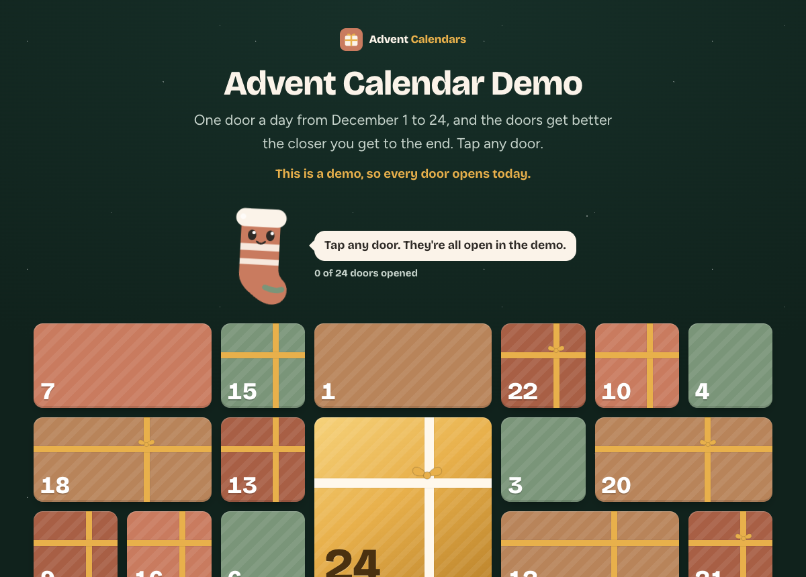
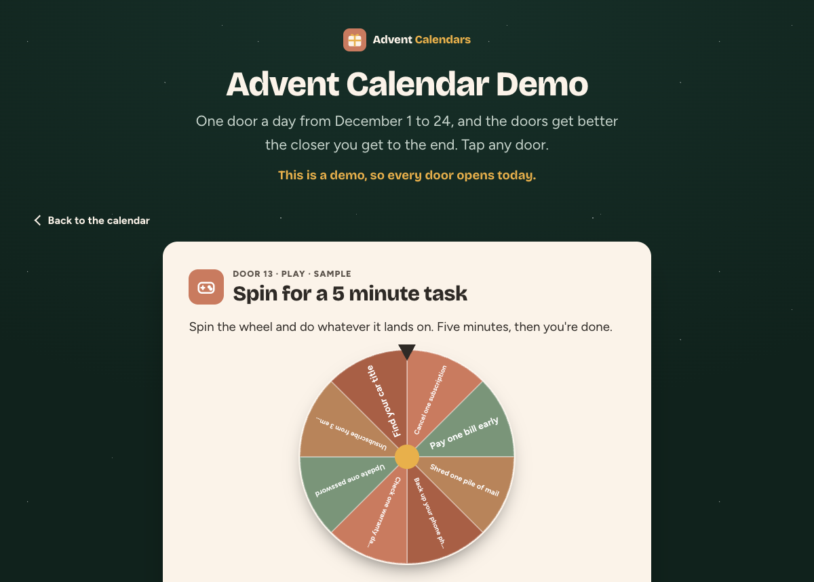
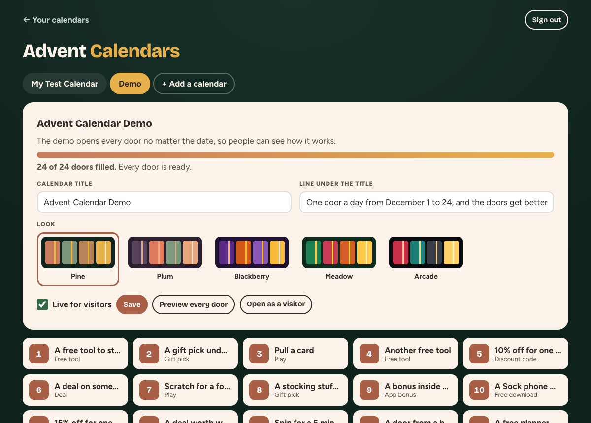

# Advent Calendar 🎁

**For bloggers and small shops who want an advent calendar on their own site.** Twenty-four doors, one opening each day from December 1 to 24 at midnight on the visitor's own clock. Put a printable, a little game, a discount code or a tip behind each door, then embed the calendar in any page.

**[See it running at advent.jenbuiltit.com](https://advent.jenbuiltit.com)**, where four calendars open this December. Or run your own copy with the code in this repo.



---

## What it does

| Part | What you get |
|---|---|
| **The calendar** | 24 wrapped doors in a shuffled grid. On the page, a door opens at midnight on the visitor's own clock. The server never sends a locked door's contents, and it unlocks a door once that date has started anywhere on Earth. So someone who reads the network tab or sets their clock ahead can see a door up to about a day early (20 hours in Chicago, 14 in London), never more. |
| **Door types** | Free tool, discount code, app bonus, deal, gift pick, tip, download, sponsored (marked as an ad) and surprise. |
| **Play doors** | Five small games: draw a card, spin the wheel, scratch-off, shake the box and make a lock screen. You type the items, one per line. |
| **One-day codes** | A code door says when its code ends, and shows it as expired after its day. The door only hides the code until about a day before. If a code has to stay secret until the exact day, switch it on in your shop that morning. |
| **Sock** | A stocking that fills up with each door the visitor opens. Opened doors are remembered in their browser only. |
| **Reminders** | An add-to-calendar button (one daily 9am reminder, Dec 1 to 24) for Google, Apple and Outlook, plus optional emails with double opt-in and one-click unsubscribe. |
| **Sharing** | "I opened door 7" share links with their own preview picture, one per door and look. |
| **Embeds** | Paste one HTML block into your page. The frame resizes itself, and shared door links land on your page with that door open once its day has come (before then, they see the grid and an "A friend just opened door N" note). For that, put your page's address in the calendar's **Post link** box in `/admin`. |
| **Admin** | An editor at `/admin` for calendars, doors, looks, previews and who signed up for reminders, with a CSV download for your newsletter tool. |
| **Five looks** | Pine, Plum, Blackberry, Meadow and Arcade. |

<p>
  
  
</p>

## Run your own copy

You'll need [Node.js](https://nodejs.org) 22 or newer and a free [Cloudflare](https://cloudflare.com) account. Email reminders need a [Resend](https://resend.com) account too.

```bash
git clone https://github.com/jensoltys/adventcalendar.git
cd adventcalendar
npm install
cp .dev.vars.example .dev.vars
# In .dev.vars, set JWT_SECRET and ADMIN_API_TOKEN (each: openssl rand -base64 48)
npx wrangler d1 execute advent-calendar-db --local --file=schema.sql
npx wrangler d1 execute advent-calendar-db --local --file=scripts/demo-doors.sql
# In wrangler.toml, set APP_URL = "http://localhost:8787" while testing
npx wrangler dev
```

Open http://localhost:8787/c/demo for the demo, and http://localhost:8787/admin/ to sign in with your `ADMIN_API_TOKEN` and add a calendar. A new calendar starts hidden with 24 empty doors.

To put it online:

```bash
npx wrangler d1 create advent-calendar-db
# Paste the database ID into wrangler.toml, and set APP_URL to your address
npx wrangler d1 execute advent-calendar-db --remote --file=schema.sql
npx wrangler d1 execute advent-calendar-db --remote --file=scripts/demo-doors.sql
npx wrangler secret put JWT_SECRET
npx wrangler secret put ADMIN_API_TOKEN
npx wrangler secret put RESEND_API_KEY   # optional: only if you want reminder emails
npx wrangler deploy
```

`npm install` puts the pinned version of Cloudflare's `wrangler` tool in this folder, and `npx wrangler` uses that one. `npm run dev` and `npm run deploy` do the same as `npx wrangler dev` and `npx wrangler deploy`.

Every setting lives in `wrangler.toml` (plain settings) or `wrangler secret put` (secrets).

| Setting | Needed? | What it's for |
|---|---|---|
| `JWT_SECRET` | Required | Signs preview, confirm and unsubscribe links. The site won't run if it's under 32 characters. |
| `ADMIN_API_TOKEN` | Required | Your password for `/admin`. Admin stays locked if it's missing or under 32 characters. |
| `APP_URL` | Required | Your site's address. Reminder sign-ups only work from this address. |
| `EMBED_ORIGINS` | To embed | Sites allowed to show a calendar in an iframe, like `https://myblog.com https://www.myblog.com`. Put spaces or commas between them. |
| `HOME_HOSTS` | Optional | Sites a calendar's **Post link** (set in `/admin`) may point to, like `myblog.com, shop.myblog.com`. Shared door links then land on that page with the door open. |
| `RESEND_API_KEY`, `EMAIL_FROM` | For email | Reminder emails. `EMAIL_FROM` must be on a domain you verified in Resend. Without both, no email is sent and the reminder box stays hidden. |
| `MAIL_ADDRESS` | **Required for email** | Your business name and postal address, printed in every email (US anti-spam law requires one). Leave it blank and no email goes out at all, and the sign-up box stays hidden. |
| `EMAIL_FROM_NAME` | Optional | The sender name. Blank uses the calendar's title. |
| `ALERT_EMAIL` | Optional | Where an email goes each time someone confirms, and when sign-ups near the cap. |
| `NEWSLETTER_NAME` | Optional | Shows an "also send me the ... newsletter" box. You download the list from `/admin` and import it yourself. |
| `OWN_HOSTS` | Optional | Your own sites. Door links to them get no "affiliate" label. |
| `AFFILIATE_ORIGINS` | Optional | Amazon links on a door only show when the calendar is embedded on one of these sites, next to the Amazon Associates line. |
| `TURNSTILE_SITEKEY`, `TURNSTILE_SECRET` | Recommended | Cloudflare's bot check on the reminder box. It switches on once both are set. |
| `SECURITY_CONTACT` | Optional | An email for `/.well-known/security.txt`. |

The email caps live at the top of `src/lib/remind.js`: 50 people across all calendars, so at most 50 door emails and 10 confirm emails a day. If you set `ALERT_EMAIL`, owner alerts add up to 22 more (20 sign-up alerts and 2 cap alerts), so the busiest day is about 82 emails, under Resend's free plan of 100 a day. Raise `SUB_CAP` and `EMAIL_DAILY_CAP` together if you move to a bigger plan.

**Putting files behind a door:** drop them in `public/doors/`, redeploy, and use a link like `/doors/my-printable.pdf` on a Download door. Give the file a random tail (`my-printable-4e9b94f7.pdf`). The door's date lock covers what the door says, not the file itself, so an unguessable name is what keeps it a surprise. Downloads save under the clean name.

**The note under each door:** edit `public/nudges.js` to point people at your own things, like your shop or your socials.

**Share pictures:** `public/share/` and `public/og.png` come pre-made with a plain "Advent Calendar" line. To put your own name and address on them, run `npm install --no-save playwright-core`, then `node share-art/render.cjs "My Advent Calendar" "my-site.com"`. The script needs Google Chrome installed on your computer.

## Before you run it publicly

- Replace `YOUR BUSINESS NAME`, `YOUR BUSINESS ADDRESS`, `you@example.com` and `your-site.example` in `public/`, `YOUR STATE` and `YOUR COUNTY` (the law and courts for your terms) in `public/legal/terms.html`, and `YOUR NEWSLETTER PROVIDER` in `public/legal/privacy.html`. Set the "Last updated" date on all three legal pages to the day you publish them.
- Have your own privacy policy and terms. The pages in `public/legal/` are a starting point, not legal advice. Name your newsletter tool in the privacy page if you set `NEWSLETTER_NAME`, or delete that line if you don't. Do the same for the Cloudflare Web Analytics line.
- No affiliate links ship in this code. Any you add on your doors are yours.
- The footer has a small "Advent calendar by Jen Built It" link. Keep it if you'd like to say thanks.
- Keep a way for your visitors to get the source code. The license asks for that. Every page has a "Source code" link in its footer, and it stays visible when the calendar is embedded. If you change the code, point that link at your fork (search `public/` for `github.com/jensoltys/adventcalendar`).

## Keep your copy as safe as advent.jenbuiltit.com

- [ ] Use a long random `JWT_SECRET` and `ADMIN_API_TOKEN`, and never reuse the ones from local testing.
- [ ] Turn on Turnstile before you put the reminder box in front of the public. Without it, a few people with throwaway addresses can use up a day's email sends.
- [ ] Store keys with `wrangler secret put`, never in `wrangler.toml` or in git.
- [ ] Sign out of `/admin` on shared computers. The token stays in that browser tab until you close it or sign out.
- [ ] Watch this repo to hear about security fixes.

See [SECURITY.md](SECURITY.md) to report a problem.

## Tests

```bash
npm install
npm test   # nothing leaves your machine
```

## Made by

**Jen Soltys**. I build small apps that fix everyday annoyances at **[Jen Built It](https://jenbuiltit.com)** and write about building with AI at **[jen8n.com](https://jen8n.com)**.

If the calendar helps you, the best support is a ⭐ on this repo, or a look at the calendars at **[advent.jenbuiltit.com](https://advent.jenbuiltit.com)**.

The Sponsor button on this repo is a tip to me, the creator. It doesn't buy a plan or a license. If you fork the repo, GitHub copies that button too, so edit or delete `.github/FUNDING.yml` in your fork.

## Contributing

Bug reports and ideas are welcome in [Issues](../../issues). I'm not taking pull requests right now, which keeps the commercial license option possible. You're free to fork it and make it yours under the license below. See [CONTRIBUTING.md](CONTRIBUTING.md) and the [code of conduct](CODE_OF_CONDUCT.md).

**Getting help:** self-hosted copies are community-supported. You run your copy, so you handle its setup, updates, backups and security. [SUPPORT.md](SUPPORT.md) says where to ask.

## License

[AGPL-3.0](LICENSE). You can use, change and share this calendar. If you run a changed version as a website for other people, you have to share your changed code under the same license.

### Commercial license

Want to build it into a product without sharing your code, or run a changed version for customers without publishing your changes? You can buy a commercial license that replaces the AGPL terms for your business. Email **hello@jenbuiltit.com** with what you're building.

This project isn't affiliated with or endorsed by Amazon, Cloudflare, Resend or Google. Amazon and the Amazon logo are trademarks of Amazon.com, Inc. or its affiliates. Google Calendar is a trademark of Google LLC. Other product names belong to their owners.

## Trademarks

The license covers the code, and that includes the five looks. It doesn't cover the "Jen Built It" name or logo. Run your copy under your own name. Saying it's built on this project, or keeping the "Advent calendar by Jen Built It" footer link, is fine. Don't present your copy as advent.jenbuiltit.com, or as run or endorsed by Jen Built It.
